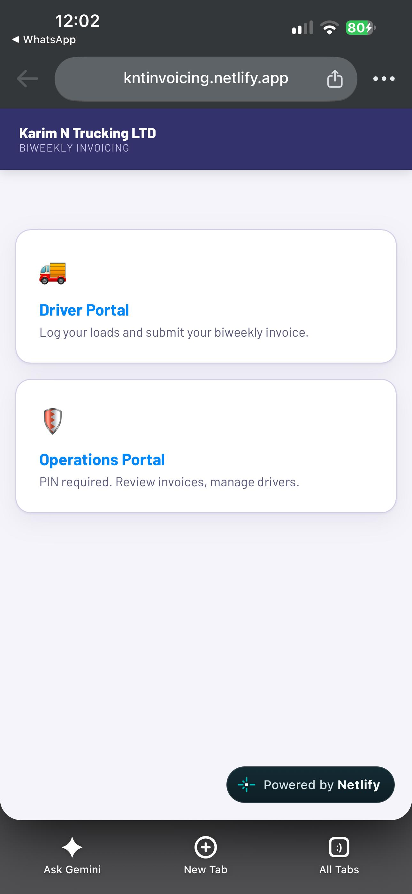
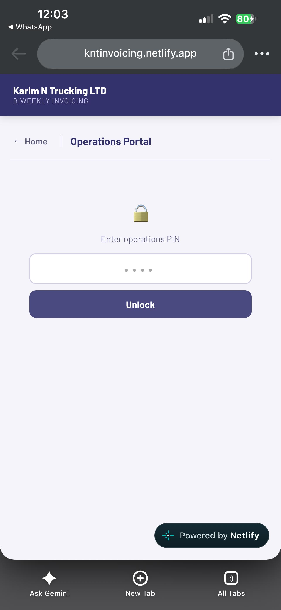
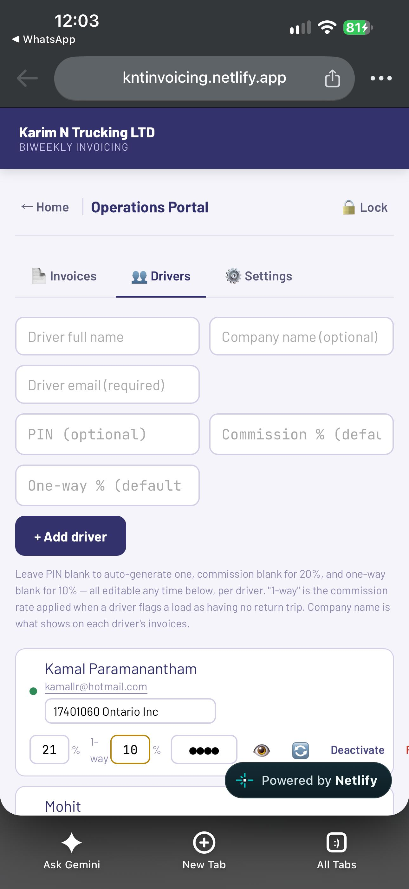

# Invoice Management Demo

A **standalone frontend portfolio application** built with HTML, CSS, and JavaScript using **fictional records only**. This is an independent demo, not a copy of a client system.

## Features
- Create demo invoices with customer and service information
- Calculate subtotal, user-entered example tax, and totals
- Search invoices by customer, service, or invoice number
- Print a demo invoice using the browser print dialog
- Restore fictional sample records
- Save demo records in browser `localStorage` (no server)

## Tech stack
HTML5, CSS3, JavaScript, DOM APIs, `localStorage`, and `Intl.NumberFormat`.

## Run locally
Open `index.html` in a browser. No credentials, build process, backend, or database are required.

## Live demo
After enabling GitHub Pages, add the live URL here.

## 📸 Application Screenshots

### 1. Invoice Dashboard

### 2. Create Invoice

### 3. Invoice Calculations

### 4. Printable Invoice Preview

## Limitations
This is **not** a production accounting tool. There is no login, cloud database, payment handling, tax advice, or backend API. The tax percentage is merely a user-entered demo value. Browser storage can be cleared.

## Privacy
Do not enter real financial or customer information. No real client code, sheets, URLs, or records are included.

**Author:** [Zankhana Panchal](https://github.com/ZankhanaPanchal)
